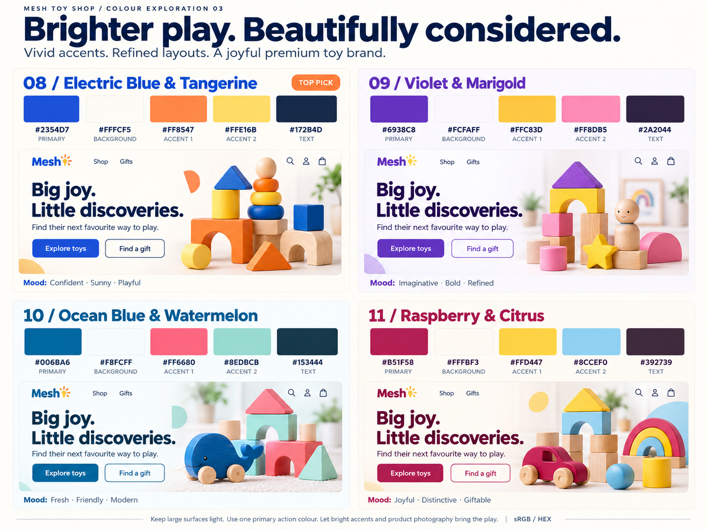

# Mesh Toy Shop — project documentation

**30 October 2026 handoff audit:** the standalone [Shopify project folder](MeshToyShop-Shopify-Project/README.md) contains the final mockups, assets, wireframes and implementation documentation. Start with its [handoff status and remaining inputs](MeshToyShop-Shopify-Project/HANDOFF-STATUS.md). The store status below is historical, not a fresh live-store verification.

**Market:** India  
**Status:** Dawn is Active; homepage expansion saved; 17 products published to Online Store; storefront password-protected  
**Last updated:** 27 October 2026 (Asia/Kolkata)

This workspace records the planning discussion, competitor research, visual concepts, catalogue capture, current Dawn build, and remaining work. The primary store at `2zs0x1-0z.myshopify.com` was renamed `meshtoyshop`; the second store's trial was canceled. Dawn was observed as Active on 25 October. All 17 approved products are Active and published to Online Store; the storefront remains password-protected. Four automatic category collections and New Arrivals are available on Online Store and sorted Newest. No payment method or app has been installed or configured during this work.

## Start here

| Document | Contents |
|---|---|
| [Project brief and decision log](docs/01-project-brief.md) | Confirmed requirements, deferred questions, discussion history, and decision status |
| [Kobbo competitor audit](docs/02-kobbo-competitor-audit.md) | Observed desktop/mobile behaviour, design system, product/cart/checkout review, trust issues, and research limits |
| [Branding and colour library](docs/03-branding-and-colours.md) | All 11 palettes, HEX codes, proposed roles, six generated images, and source prompts |
| [Store strategy and delivery plan](docs/04-store-strategy-and-roadmap.md) | Layout, product information, trust, AOV, free/paid tools, cost scenarios, launch checks, and to-do list |
| [Mesh Enterprise catalogue capture](data/meshenterprise/README.md) | Public product data, 17 listings, source links, prices, descriptions, and 83 gallery image URLs |
| [Dawn build status](docs/05-dawn-build-status.md) | Saved theme work, preview findings, catalogue checks, prepaid discount decision, and remaining work |
| [Homepage design concept 2](docs/06-homepage-design-v2.md) | Desktop and revised mobile design images, competitor comparison, and Dawn build map |
| [Desktop reference implementation](docs/07-reference-build.md) | Current selected reference, section comparison, saved draft versus local changes, validation and access blocker |
| [Latest section audit](docs/08-section-audit.md) | Corrections saved, nine-image reload verification, remaining visual/function checks and current access blocker |
| [Homepage expansion and functional audit](docs/09-homepage-expansion.md) | Current saved state, automatic collection rules, media rails, campaign imagery, functional verification and remaining launch dependencies; supersedes older build-status entries |

Latest design checkpoint: [Reviews visible on the development homepage](docs/13-homepage-review-visibility.md). Four labeled review samples now appear on the actual password-protected homepage, as explicitly requested. Desktop and mobile layouts and carousel controls are verified. Video posters remain editor-only. Design/layout comes first; product photography is deferred. Earlier layout verification is recorded in documents 10–12.

Latest strategy review draft: [Competitor and conversion analysis, 29 October 2026](docs/14-competitor-and-conversion-analysis-2026-10-29.md). It compares the four named references with three added market peers, checks the current Mesh homepage, and records open positioning, proof, and offer-economics decisions. No new design or offer was approved or implemented by this analysis.

## Current decision

The user selected **08 — Electric Blue & Tangerine** as the direction for the Dawn draft, the 17 captured products as the initial catalogue, and a **15% prepaid discount** with COD offered and no cap or minimum. The user explicitly approved imported details, prices and publication of all 17 products. The discount is not configured until payment-method enforcement can be verified. Logo and final typography remain open.

The selected desktop image guides the two-column categories and initial product grid. The dynamic reference section, hero, logo, header refinements, category showcases, family-play story, media rails and FAQs are saved in Dawn. Product frames are now square in response to the image-fit correction. Desktop/mobile overflow, carousel arrows, FAQ, search, cart opening and collection destinations have been checked. Published collection membership, all 17 product URLs, search, add-to-cart, quantity totals and removal were verified. Checkout/payment setup remains deferred. See document 09 for exact evidence.

The other colour options remain design references.

## Visual deliverables

| File | Description |
|---|---|
| [01 — Warm Teal & Coral](output/design-concepts/01-warm-teal-coral.png) | Full homepage concept |
| [02 — Bright Blue & Yellow](output/design-concepts/02-bright-blue-yellow.png) | Full homepage concept |
| [03 — Natural Green & Terracotta](output/design-concepts/03-natural-green-terracotta.png) | Full homepage concept |
| [Palettes 01–03](output/design-concepts/mesh-colour-profiles.png) | Colour roles, HEX codes, and UI samples |
| [Palettes 04–07](output/design-concepts/mesh-premium-colour-profiles.png) | Premium colour exploration |
| [Palettes 08–11](output/design-concepts/mesh-bright-premium-palettes.png) | Brighter premium colour exploration; palette 08 guides the draft |
| [Dawn hero artwork](output/design-concepts/mesh-dawn-hero.png) | Original artwork used in the draft theme |

The earlier homepage mockups are AI-generated concepts with illustrative products and prices. The Dawn hero and current category illustrations are original decorative artwork, not catalogue claims. Product cards use actual catalogue media. Exact HEX specifications are recorded in the colour library.

## Working preference

Use **Tabbit browser** for Shopify implementation and browser review, as requested by the user. The user has directed a Dawn build with products and complete design/features. The user approved publication of all 17 products. Dawn is Active; storefront password protection remains in place.

Work as a senior Shopify developer with marketing expertise. Apply the four Karpathy-inspired principles in [AGENTS.md](AGENTS.md): think before coding, simplicity first, surgical changes, and verified outcomes. Ground theme, app, and design recommendations in current evidence and the store's measured results.

## Current homepage handoff — 30 October 2026

The user declared the homepage design phase complete. Use [the Shopify project handoff](MeshToyShop-Shopify-Project/README.md), [visual reference gallery](MeshToyShop-Shopify-Project/START-HERE.html), [technical handbook](MeshToyShop-Shopify-Project/TECHNICAL-HANDBOOK.html) and [responsive wireframes](MeshToyShop-Shopify-Project/wireframes/index.html). Its authority register supersedes older conflicting design/status notes. The eight selected/latest reference boards are preserved unchanged; operational launch dependencies remain explicit.

## Earlier next-step note — superseded by the handoff above

Latest proposal: [next-section product discovery](docs/17-next-section-discovery-2026-10-29.md), including the expanded Mesh Enterprise catalog scope and [desktop/mobile mockup](output/design-concepts/mesh-next-section-discovery-v3.png). Unapproved; no theme changes.

Continue design and layout first, including footer/navigation and responsive consistency. Product photography is deferred. Genuine media and shipping/returns/stock/payment configuration remain later launch dependencies. See the prioritized [to-do list](docs/11-layout-priority-and-media.md).
