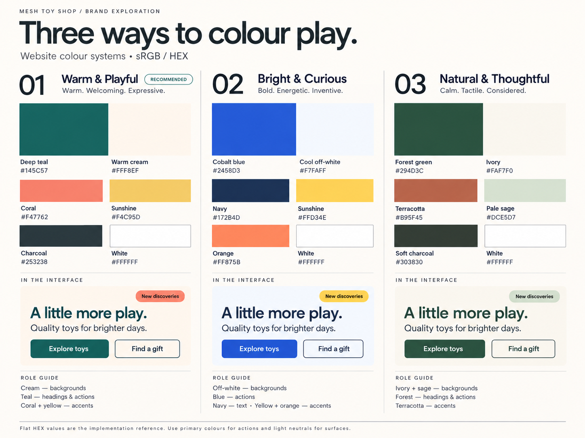
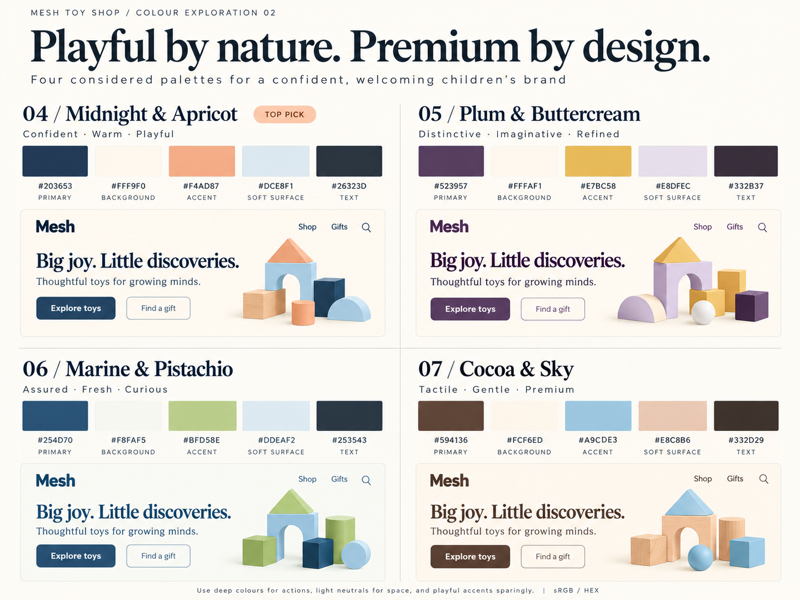
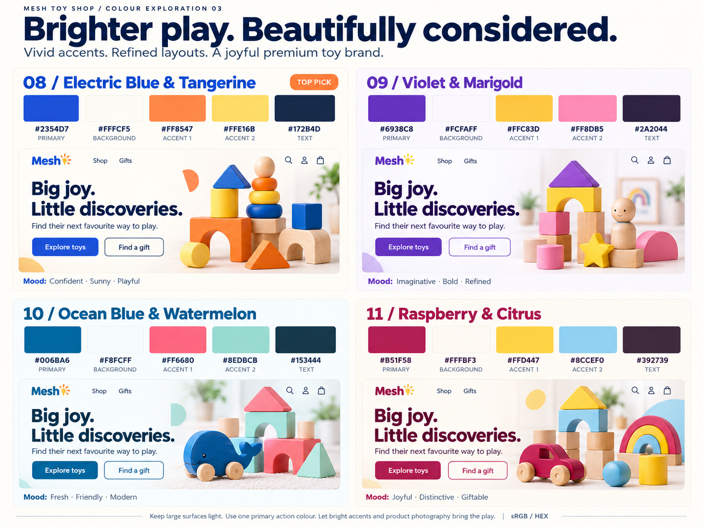
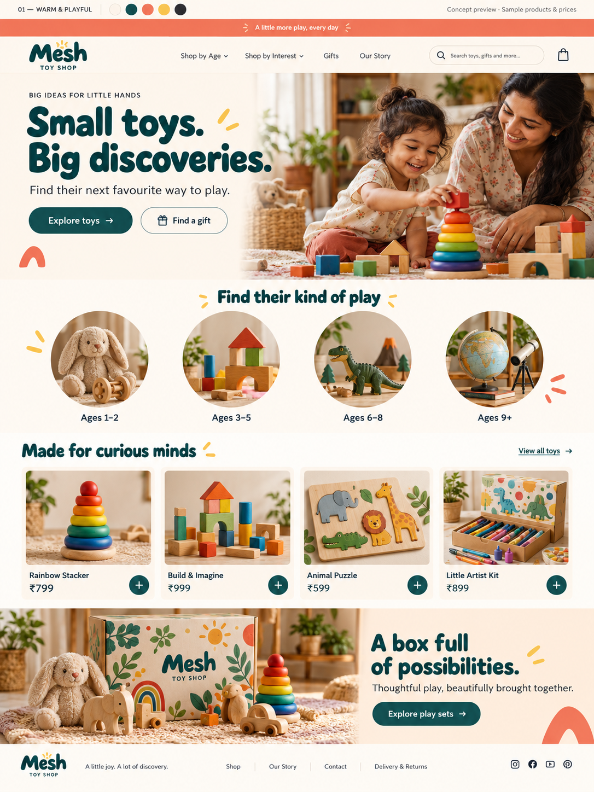
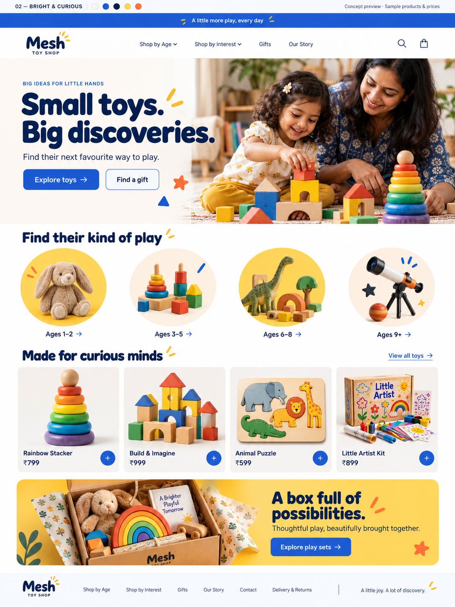
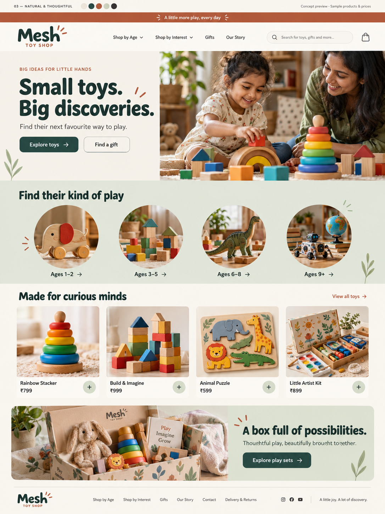

# Branding and colour library

Updated: 23 October 2026  
Status: Palette 08 selected for the Dawn draft; logo, font, and final responsive layout remain open.

Reconfirmed 30 October 2026: user explicitly selected palette 08 again and requested more realistic photography. Cobalt #2354D7, cream #FFFCF5, tangerine #FF8547, yellow #FFE16B and navy #172B4D remain the exact implementation tokens. Keep actual toy colours unchanged. Use candid expressions, natural daylight and real material/skin texture; generated lifestyle mockups are concepts, not customer evidence. See [growth, FAQ and WhatsApp revisions](22-growth-faq-whatsapp-2026-10-30.md).

## 1. Direction of travel

The exploration moved from warm/playful, through restrained premium, to **brighter premium** after the user's latest feedback.

Current design objective:
- Appealing to children without looking cluttered or childish.
- Clear and reassuring to adult purchasers.
- Premium through consistency, spacing, typography, imagery, and finish.
- Bright through controlled accents and colourful products.
- Suitable for an Indian toy store.

Colour can support an impression of confidence; it cannot establish product safety, business reliability, or customer trust by itself.

## 2. Colour specification conventions

- Colour space: sRGB for digital assets.
- Listed HEX values are the implementation reference.
- Generated image swatches may differ slightly in pixel colour.
- Use deep primary colours for clear actions, light surfaces for content, and accents selectively.
- Do not recolour real product photos to match the brand.
- Check final text/background combinations, focus states, hover states, borders, disabled states, and error/success UI during implementation.
- A single purchase-action colour should be consistent across product cards, product pages, and cart.
- Interface colours and logo colours should relate, but the logo need not use every palette colour.

## 3. First exploration: palettes 01–03

### 01 — Warm & Playful / Teal & Coral

Intent: welcoming, warm, expressive.

| Role | Name | HEX |
|---|---|---|
| Background | Warm cream | #FFF8EF |
| Primary actions / headings | Deep teal | #145C57 |
| Accent | Coral | #F47762 |
| Small highlight | Sunshine yellow | #F4C95D |
| Body text | Charcoal | #253238 |
| Cards / primary-button text | White | #FFFFFF |

Usage: cream dominates; teal guides shopping; coral and yellow add personality. White on teal is approximately 7.78:1 contrast. White on coral is approximately 2.74:1, while charcoal #253238 on coral is approximately 4.81:1. Use dark labels on coral/yellow rather than assuming white text works.

Initial assistant recommendation, not user selection.

### 02 — Bright & Curious / Blue & Yellow

Intent: energetic, modern, bold.

| Role | Name | HEX |
|---|---|---|
| Background | Cool off-white | #F7FAFF |
| Primary actions / links | Cobalt blue | #2458D3 |
| Headings / text | Navy | #172B4D |
| Section / category accent | Sunshine yellow | #FFD34E |
| Small highlight | Orange | #FF875B |
| Cards / primary-button text | White | #FFFFFF |

Usage: predominantly light surfaces, cobalt shopping actions, navy text, selective yellow sections. Dark text on yellow/orange.

### 03 — Natural & Thoughtful / Green & Terracotta

Intent: calm, tactile, understated.

| Role | Name | HEX |
|---|---|---|
| Background | Ivory | #FAF7F0 |
| Primary actions / headings | Forest green | #294D3C |
| Accent | Terracotta | #B95F45 |
| Soft surface | Pale sage | #DCE5D7 |
| Body text | Soft charcoal | #303830 |
| Cards / primary-button text | White | #FFFFFF |

Usage: ivory and sage create calm surfaces; forest anchors actions; terracotta adds warmth. A stronger fit for a natural/wooden-toy direction than the user's latest request for brighter colours.

## 4. Premium exploration: palettes 04–07

| ID / name | Primary | Background | Accent | Soft surface | Text |
|---|---|---|---|---|---|
| 04 Midnight & Apricot | #203653 | #FFF9F0 | #F4AD87 | #DCE8F1 | #26323D |
| 05 Plum & Buttercream | #523957 | #FFFAF1 | #E7BC58 | #E8DFEC | #332B37 |
| 06 Marine & Pistachio | #254D70 | #F8FAF5 | #BFD58E | #DDEAF2 | #253543 |
| 07 Cocoa & Sky | #594136 | #FCF6ED | #A9CDE3 | #E8C8B6 | #332D29 |

### 04 — Midnight & Apricot
- Primary: midnight navy.
- Background: porcelain cream.
- Accent: apricot.
- Soft surface: mist blue.
- Text: graphite.
- Mood: confident, warm, playful.
- Assistant recommendation within this exploration; not approved.
- Deep navy actions with white text; apricot/mist accents on light surfaces.

### 05 — Plum & Buttercream
- Primary: deep plum.
- Background: buttercream.
- Accent: muted golden yellow.
- Soft surface: lavender mist.
- Text: ink plum.
- Mood: distinctive, imaginative, refined.
- A creative alternative to familiar blue/green toy-store branding.

### 06 — Marine & Pistachio
- Primary: marine blue.
- Background: soft chalk.
- Accent: pistachio.
- Soft surface: powder blue.
- Text: dark slate.
- Mood: assured, fresh, curious.
- Crisp light surfaces with restrained fresh green accents.

### 07 — Cocoa & Sky
- Primary: cocoa brown.
- Background: oat milk.
- Accent: soft sky blue.
- Soft surface: warm peach.
- Text: espresso.
- Mood: tactile, gentle, premium.
- Proposed fit for wooden toys and gift-oriented presentation; not a confirmed catalogue direction.

The generated board uses a more editorial type treatment than the first homepage concepts. This is exploration, not a font decision.

## 5. Latest exploration: brighter premium palettes 08–11

| ID / name | Primary | Background | Accent 1 | Accent 2 | Text |
|---|---|---|---|---|---|
| 08 Electric Blue & Tangerine | #2354D7 | #FFFCF5 | #FF8547 | #FFE16B | #172B4D |
| 09 Violet & Marigold | #6938C8 | #FCFAFF | #FFC83D | #FF8DB5 | #2A2044 |
| 10 Ocean Blue & Watermelon | #006BA6 | #F8FCFF | #FF6680 | #8EDBCB | #153444 |
| 11 Raspberry & Citrus | #B51F58 | #FFFBF3 | #FFD447 | #8CCEF0 | #392739 |

### 08 — Electric Blue & Tangerine
Mood: confident, sunny, playful.
- Cobalt primary actions with white text.
- Warm-white main surfaces.
- Tangerine and yellow accents.
- Navy text.
- Selected by the user as the working direction for the Dawn draft.

### 09 — Violet & Marigold
Mood: imaginative, bold, refined.
- Violet primary actions.
- Very light lilac-white surfaces.
- Marigold and pink accents.
- Deep purple text.
- Distinctive creative direction.

### 10 — Ocean Blue & Watermelon
Mood: fresh, friendly, modern.
- Ocean-blue primary actions.
- Cool white surfaces.
- Watermelon pink and mint accents.
- Dark blue text.
- A lighter, welcoming contemporary direction.

### 11 — Raspberry & Citrus
Mood: joyful, distinctive, giftable.
- Deep raspberry actions.
- Warm-white surfaces.
- Citrus yellow and sky-blue accents.
- Dark plum text.
- Expressive boutique/gifting direction.

Suggested starting balance for these bright palettes: roughly 65–75% light surfaces with colour concentrated in actions, accents, and imagery. This is art-direction guidance, not a rigid rule.

## 6. Full homepage mockups

The three full homepage images use similar information architecture so colour and styling can be compared. Their composition and imagery are not pixel-identical.

### 01 — Warm Teal & Coral

### 02 — Bright Blue & Yellow

### 03 — Natural Green & Terracotta

Shared structure:
1. Concept label and palette swatches outside the storefront.
2. Announcement strip.
3. Header with Mesh wordmark, shopping navigation, search, and bag.
4. Split hero with copy, two actions, and parent/child play imagery.
5. Four age-category cards.
6. Four product cards.
7. Curated gift-set banner.
8. Compact footer.

Illustrative age categories:
- 1–2
- 3–5
- 6–8
- 9+

Illustrative products/prices:
- Rainbow Stacker — ₹799.
- Build & Imagine — ₹999.
- Animal Puzzle — ₹599.
- Little Artist Kit — ₹899.

These are not user-supplied products or prices. Illustrated products must not be assumed suitable for those ages. Product imagery, packaging, logos, and copy are synthetic concept material.

## 7. Provisional component design guidance

Typography:
- One expressive heading family and one readable body family.
- Suggested desktop hero range: 48–64px.
- Suggested mobile hero range: 34–40px.
- Suggested section-heading range: 28–36px.
- Product-description body starting point: 16px.
- Final font selection remains open; do not infer a specific font from AI-rendered lettering.

Layout:
- Consistent content widths and spacing.
- Clear heading hierarchy.
- Short mobile-friendly product titles.
- Generous clickable areas.
- Consistent product-image ratios.
- Restrained shadows and decorative shapes.

Logo:
- Readable Mesh wordmark.
- Toy Shop descriptor.
- Optional small building-block, interlocking-shape, or sun-like detail.
- Generated wordmarks are exploratory and not production vector artwork.

Photography:
- Clean main product image.
- In-use/scale image.
- Included-contents image.
- Relevant detail images.
- Short actual demonstration.
- Packaging where it supports the purchase.

## 8. Generation record and prompts

All six images were generated using the built-in image-generation tool. Original generated files were retained; workspace copies are under output/design-concepts.

| Deliverable | Source prompt |
|---|---|
| Three full homepage concepts | [prompts.md](../output/design-concepts/prompts.md) |
| Palettes 01–03 | [colour-profile-prompt.md](../output/design-concepts/colour-profile-prompt.md) |
| Palettes 04–07 | [premium-colour-profile-prompt.md](../output/design-concepts/premium-colour-profile-prompt.md) |
| Palettes 08–11 | [bright-premium-prompt.md](../output/design-concepts/bright-premium-prompt.md) |

The prompts record exact intended colours and art direction. Palette 08 now guides the Dawn draft. The implementation and outstanding visual QA are recorded in [Dawn build status](05-dawn-build-status.md).
