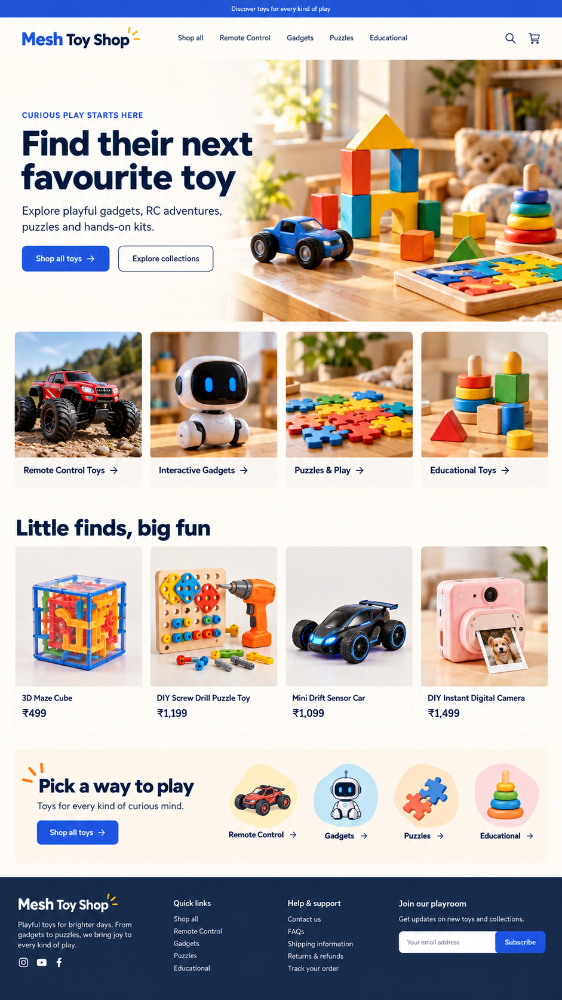
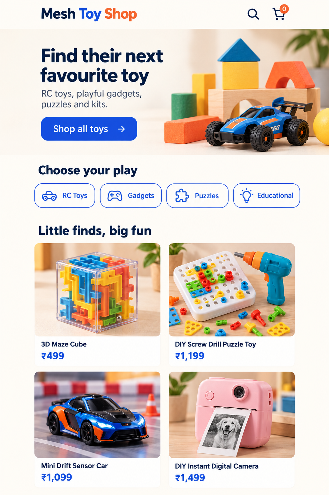

# Homepage design concept 2

Created: 23 October 2026 (Asia/Kolkata)

**Superseded direction, 24 October:** The user subsequently chose the tall attached reference for desktop, including two-column categories and products. The compact mobile-v3 preference and four-column desktop build map below are historical proposals. Use [Desktop reference implementation](07-reference-build.md) for current requirements and progress.

These are **design images**, not screenshots of the Shopify store. The toy and product pictures in them are AI-generated illustrations. Product names and displayed prices were taken from the 17 captured Mesh Enterprise listings, but prices, product identity, photo rights, and details still need merchant verification. Do not use the generated product pictures as actual listing photography.

## Competitor evidence and design choice

The live Kobbo homepage did not load through the research tool on this date. The comparison uses the [archived Kobbo desktop and mobile captures](evidence/kobbo/README.md) and the [earlier audit](02-kobbo-competitor-audit.md), not a claim about its current live performance.

The archived Kobbo homepage has a memorable child-focused hero, clear age-based entry points, consistent yellow accents, and polished photography. Its inspected mobile view places the first product section below the first viewport and uses a large age-led hero. Mesh's captured catalogue spans RC toys, gadgets, puzzles, and one educational kit; verified age suitability is not yet available. The new design therefore uses those four real categories as primary paths and brings product cards up after a compact mobile hero and category row. This is a usability hypothesis, **not proof of higher conversion or speed**.

## Direction

- Clean warm-white field, navy type, cobalt actions, tangerine and yellow accents. One primary action colour.
- A strong, readable text-led hero beside original toy imagery. No text over busy photography.
- Four category paths immediately below the desktop hero; compact category controls after the mobile hero.
- One four-product section with consistent imagery, names, and INR prices close to the top.
- No invented reviews, safety badges, developmental claims, scarcity, discount promise, or delivery claims.
- Short footer and genuine service links once their content exists.

## Build map for the Dawn draft

| Concept area | Smallest practical implementation |
|---|---|
| Announcement and header | Existing Dawn sections; replace default navigation with collection links after review |
| Hero | Keep one original lightweight banner asset and use readable navy text on a solid warm-white panel; check desktop and mobile crops |
| Four category paths | Rework existing multicolumn section to four desktop columns, two mobile columns or compact text links; use actual collection imagery |
| Product row | Dawn featured collection after products and collections are approved for publication; use actual product photos |
| Footer | Dawn footer menu and newsletter; include support/policy destinations only once accurate pages exist |
| 15% prepaid | Leave out of design until a tested payment-method rule is active |

Do not embed either full-page concept image as a storefront asset. Build the layout from theme sections so text remains accessible, responsive, editable, and fast to load. The exact illustrated desktop layout may require small theme CSS changes; the initial pass should use Dawn's native sections.

## Prompt record

Generated with the built-in image generation tool. The desktop prompt requested a high-fidelity original 1440px-feel ecommerce homepage with palette 08, an ivory text-led hero and generic toy still-life, four category tiles, a four-product row using captured names/prices, an editorial category panel, and a compact footer. It prohibited competitor branding, fabricated reviews, age and safety claims, sale prices, delivery promises, and prepaid promotion.

The final mobile prompt requested a 390px-feel screenshot with a compact hero, four horizontal category controls, and the same four products immediately after them. It specified high-contrast navy copy, cobalt action, uniform product cards, no false trust claims, and product cards beginning near the first phone viewport. The initial, taller mobile exploration is retained as [mobile v2](../output/design-concepts/mesh-home-mobile-v2.png); the compact [mobile v3](../output/design-concepts/mesh-home-mobile-v3.png) is the preferred direction.
